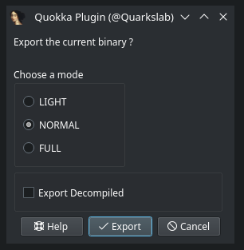

# Quokka

<p align="center">
	
</p>

image generated by [DALL-E](https://labs.openai.com/s/3k4LtWP564OYrVCIeoGmefMB)

---

Quokka is a binary exporter: from the disassembly of a program, it generates
an export file that can be used without the disassembler. It supports
**IDA Pro**, **Ghidra** and **Binary Ninja** as disassembly backends.

The main objective of **Quokka** is to enable to completely manipulate the
binary without ever opening a disassembler after the initial export. Moreover, it
abstracts the disassembler's API to expose a clean interface to the users.

Quokka is heavily inspired by [BinExport](https://github.com/google/binexport),
the binary exporter used by BinDiff.

## Architecture

```
     IDA Pro               Ghidra               Binary Ninja
        │                      │                      │
IDA Plugin (C++)    Ghidra Plugin (Java)   BinaryNinja Plugin (Python)
        │                      │                      │
        └────────────── quokka.proto ─────────────────┘
                     (protobuf schema)
                              │
                        .quokka files
                              │
              Python bindings (quokka.Program)
              ├── Capstone backend (primary)
              └── Pypcode backend (optional)
```

## Installation

| Component | Install | Needed for |
|---|---|---|
| Python library + CLI | `pip install quokka-project` | reading `.quokka` files (always) |
| IDA plugin (IDA 9.1+) | `hcli plugin install quokka` (IDA 9.2+), or `quokka_plugin.so` from [Releases](https://github.com/quarkslab/quokka/releases) into IDA's `plugins` directory | exporting with IDA |
| Ghidra extension (>= 12.0.3) | see [ghidra_extension/README.md](ghidra_extension/README.md) | exporting with Ghidra |
| Binary Ninja plugin | see [binaryninja_extension/README.md](binaryninja_extension/README.md) | exporting with Binary Ninja |

Building from source (IDA SDK >= 9.2 is fetched automatically, older SDKs via
`-DIdaSdk_ROOT_DIR`): see [Installation](docs/installation.md#ida-plugin).

## Quick start

Export from inside the disassembler (IDA: `Alt+A`; Ghidra: `File > Export Program > Quokka`):



or headless:

```commandline
$ quokka-cli /bin/ls                          # -> /bin/ls.quokka (auto-detects IDA or Ghidra)
$ quokka-cli --backend ghidra -t 8 dir/       # a whole directory, 8 workers
$ quokka-cli -o "%p/exports/%f.quokka" bin    # output template
```

Load and analyze:

```python
import quokka

prog = quokka.Program("ls.quokka", "/bin/ls")   # export file + original binary
prog = quokka.Program.from_binary("/bin/ls")    # or export and load in one step

for func in prog.values():
    print(func.name, len(func))
```

Edit and write back:

```python
prog.add_type("struct context { int id; char name[64]; };")
prog.write()                                              # save the .quokka file
prog.commit(database_file="ls.i64", overwrite=True)       # apply to the IDA database (or a Ghidra project)
```

Two export modes exist: **LIGHT** (block-level data; instructions decoded at
runtime by Capstone from the original binary) and **FULL** / self-contained
(instructions and operands exported; produced by the Ghidra and Binary Ninja
exporters, not yet by the IDA plugin). Both expose the same Python API.

## Documentation

- [Online documentation](https://quarkslab.github.io/quokka/): [usage](docs/usage.md) (all export options, headless IDA / Ghidra / Binary Ninja, CLI, modes), [editing](docs/write_feature.md), [API reference](https://quarkslab.github.io/quokka/)
- [FAQ](docs/FAQ.md) -- [Roadmap](docs/roadmap.md) -- [Contributing](CONTRIBUTING.md) -- [Tests](tests/README.md)
